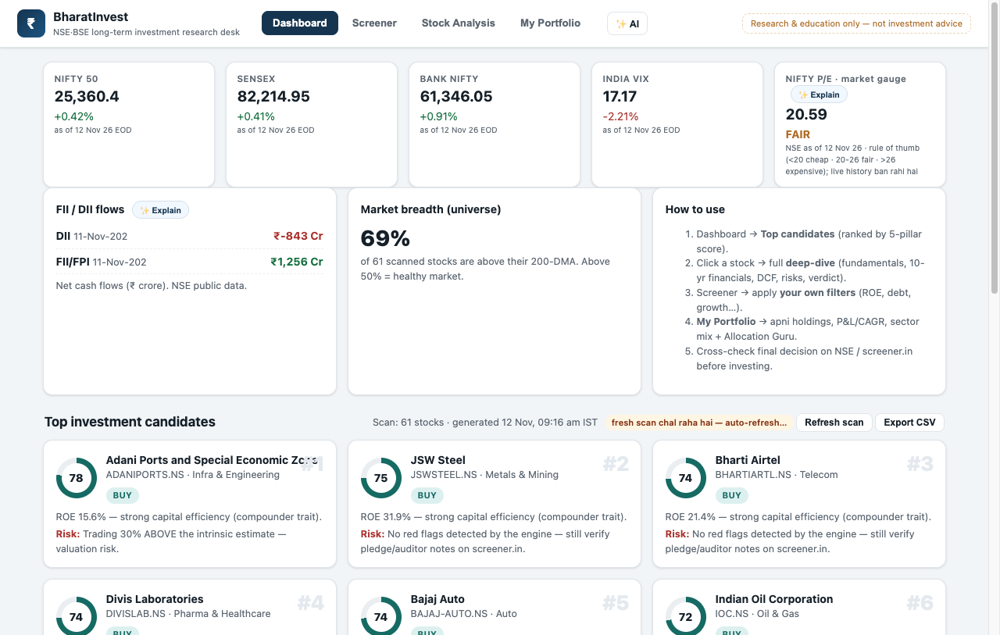
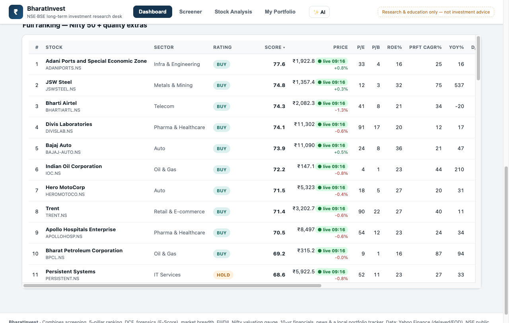
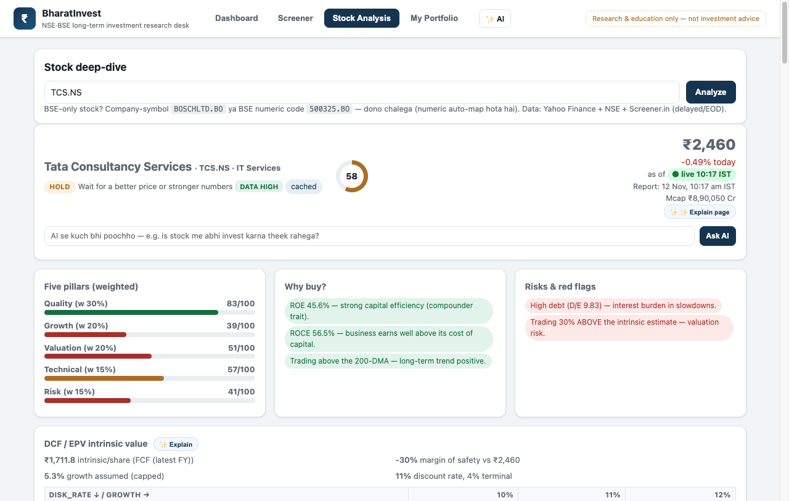
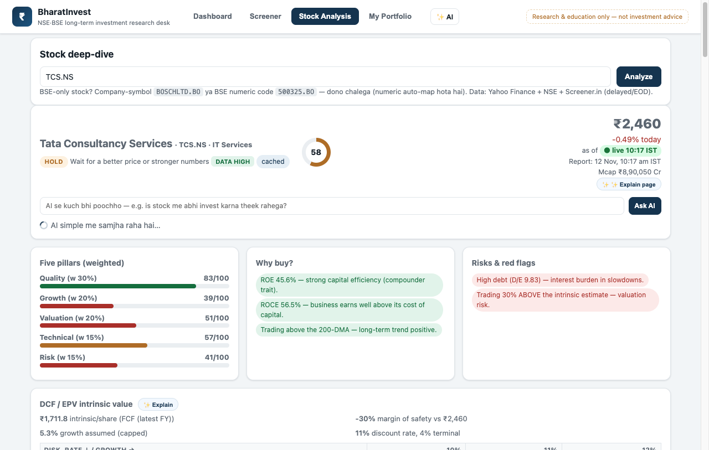
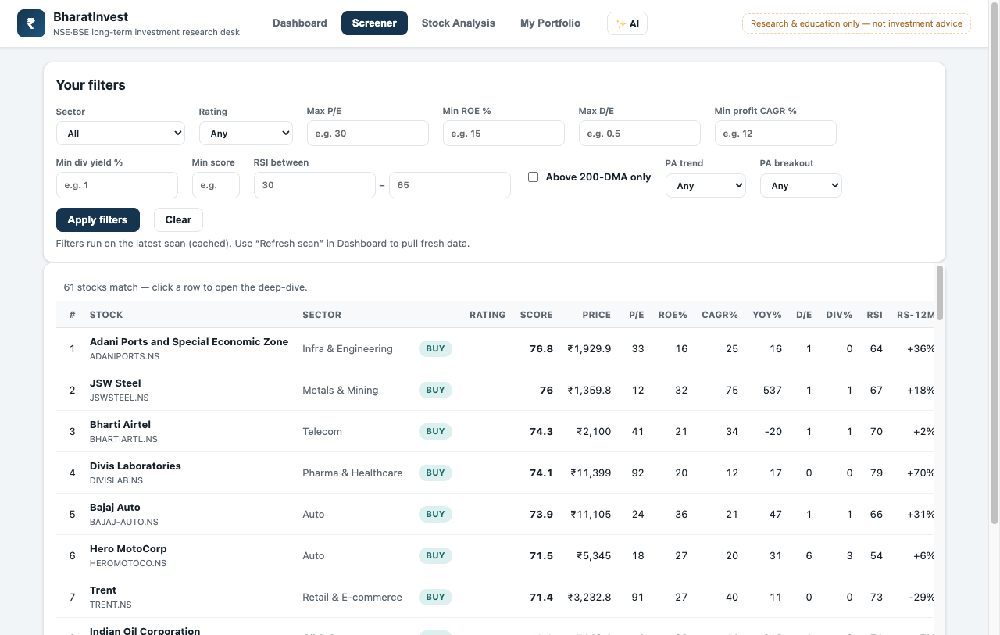
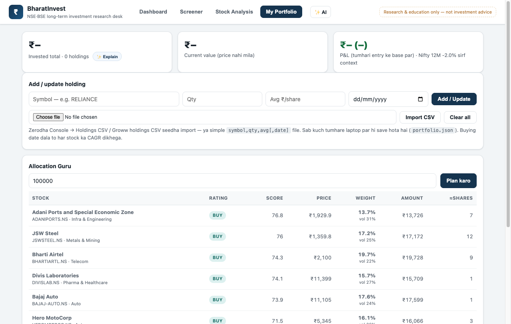
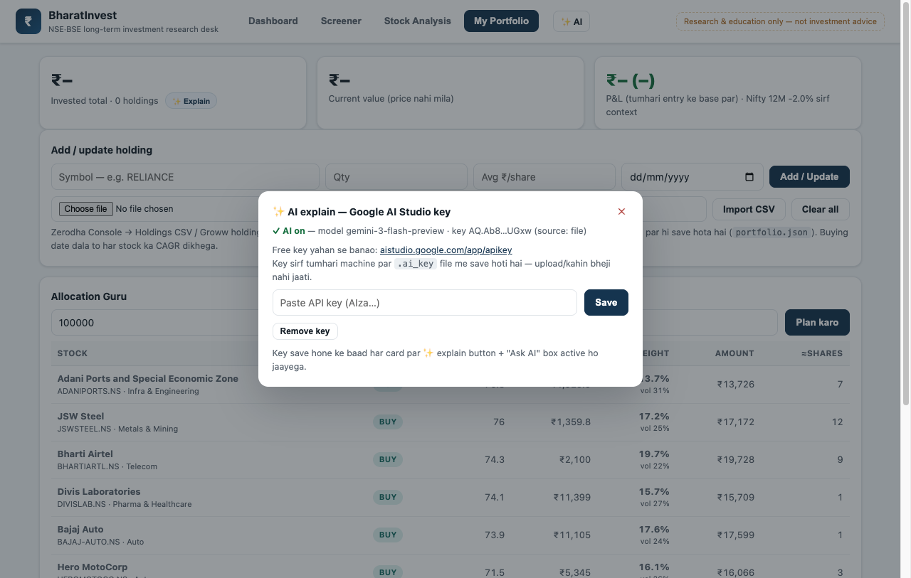
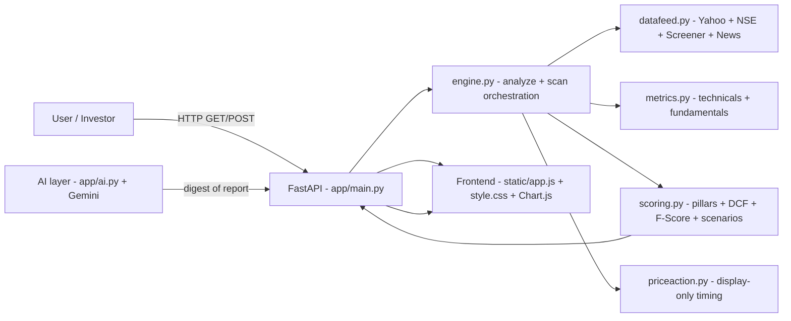

<p align="center">
  
</p>

<h1 align="center">💼 BharatInvest</h1>

<p align="center">
  <b>Indian stock investment research desk</b> — screens, scores, DCF, AI simple bhasha
</p>

<p align="center">
  
  
  
  
  
  
  
</p>

<p align="center">
  
  
  
  
</p>

---

## 🧠 What is BharatInvest?

**BharatInvest** ek AI-powered Indian stock research web app hai — jisme aap kisi bhi NSE/BSE stock ko open karte ho aur **poor research report, score, charts, risks aur AI simple-explanation** mil jaati hai.

**Hamara manna:** aapki bachchi (bilkul naya investor) jo market se dar lagta hai, ko wo sahi jagah par **seekh** deta hai — kitna invest karna, kis company se — bina technical language ki mushkilat ke.

**Unique promise:**
- 🏛️ **Long-term only** — intraday ya momentum trading nahi, sirf sahi se badhi aur stable companyon ka ye badlav.
- 🧹 **Clean & simple UI** — jaise koi modern SaaS product ho: bhi toh charts hain, bhi toh data hain, lekin **English bhi, Hinglish bhi, Simple bhi**.
- 🤖 **AI explains everything in simple Hinglish** — jo bhi number dikhta hai use samjhta hai.
- 🔒 **Zero broker integration** — koi real order nahi, koi risk na lo; educational research only.

---

## 🖼️ Screenshots — Live App

### 🏠 Dashboard — market pulse + top candidates



### 📊 Full ranking — Nifty 50 + quality extras



### 📈 Stock deep-dive — fundamentals + verdict



### ✨ AI Simple Explanation + glossary chips



### 🧪 Screener — your own filters



### 💼 Portfolio + Allocation Guru



### ⚙️ AI settings modal (key add karna)



---

## ✨ Main Features

| Area | Kya hai | Bhejta hai |
|---|---|---|
| **🔍 Screening** | 62 NSE stocks (Nifty 50 + quality extras) ke liye scan: Quality, Growth, Valuation, Technical, Risk pillars. | `top candidates` ranked + full ranking table |
| **📈 Live prices** | Market hours (09:15–15:30 IST) me Yahoo 1-minute intraday data. | Live price + live chips UI-wide + 60 sec cache |
| **🧮 Scoring** | 5 pillars (Quality 30, Growth 20, Valuation 20, Technical 15, Risk 15). | STRONG BUY ≥ 78 · BUY ≥ 68 · HOLD ≥ 55 · AVOID (for now) ≥ 40 |
| **🔬 DCF / Valuation** | Two-stage DCF + EPV + bull/bear scenarios + margin of safety. | `Intrinsic value`, `MOS%` explained by AI |
| **🧪 Piotroski F-Score** | 9-point financial health check (from 10-year statements). | Breakdown + AI explanation |
| **📊 Price Action** | Breakout, retest, support/resistance, volume, MTF alignment → display-only timing layer. | BUY_ZONE / WAIT / CAUTION / NEUTRAL signals |
| **📰 News & Announcements** | NSE corporate announcements + Google News headlines per stock. | Filter by category |
| **💼 Portfolio** | Local holdings (JSON / Zerodha & Groww CSV import) + P&L, CAGR, sector mix. | Allocation Guru (inverse-vol budget, 35% cap/stock) |
| **🔭 FII/DII + Nifty Valuation** | Live flows + Nifty P/E gauge. | `AI Explain` from dashboard |
| **✨ AI Explain** | Google AI Studio (Gemini) integration. | Explain page, per-card ✨, Ask AI, glossary chips — all simple Hinglish |

## 🤖 AI — Simple Hinglish Explainer

- Har card par **✨ Explain** button — Fundamentals, Technicals, DCF, Price Action, Verdict, Checklist, Statements.
- Deep-dive header me **"✨ Explain page"** — poora report ek 2-minute friendly explanation me.
- **"Ask AI"** box — us stock ke report ke against aap koi bhi sawaal pooch sakte ho.
- Har answer me **summary + 6 points + glossary chips** (term → simple meaning) + education-only note.
- **AI sirf explains** — kabhi score/verdict override nahi karta, kabhi advice nahi deta.
- Model fallback chain: `gemini-3-flash-preview → gemini-3.8-flash → gemini-flash-latest` (Google ke changes handle hota hai).
- Disk cache: same content → same explanation (7 days), quota bachta hai.

## 🛠️ Technologies Used (jo tech use ki humne)

| Layer | Technology |
|---|---|
| Backend | Python 3.14, FastAPI, Uvicorn, Pydantic |
| Data + ML engines | pandas, yfinance, PyYAML, requests |
| External data | Yahoo Finance, NSE public endpoints, Screener.in, Google News |
| AI layer | Google AI Studio (Gemini) via REST — zero new dependency |
| Frontend | Vanilla JS, custom CSS, Chart.js (CDN) — no build step |
| Dev ops | Uvicorn server, uvicorn reload |

## 🏗️ Architecture



## 🚀 Quick Start

```bash
git clone <your-repo-url>
cd BharatInvest
python -m venv .venv && source .venv/bin/activate
pip install -r requirements.txt
python run.py          # or: uvicorn app.main:app --reload
```

Then open **http://127.0.0.1:8000**

---

## ⚖️ Disclaimer

**BharatInvest educational research tool hai. Koi investment advice nahi deta. Financial markets risky hain — always cross-check numbers on NSE / Screener.in before investing.**

---

<p align="center">
  Made with ❤️ in simple Hinglish — research, screen, score, AI explain.
</p>
